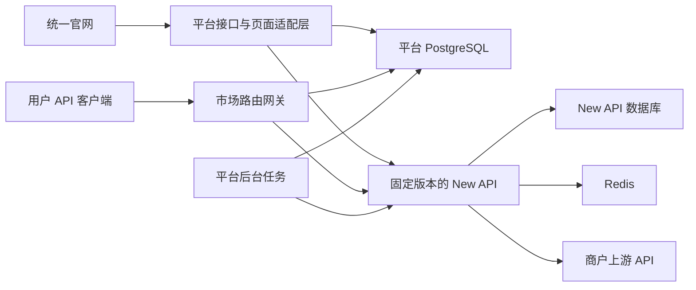

# API 聚合交易平台设计规范

## 1. 业务结论

建设一个同时面向普通用户、商户和管理员的统一官网。New API 作为独立部署的内部服务，继续承载账号、API 密钥、余额、渠道转发、缓存计费、退款和用量日志。充值订单、易支付签名与回调由外围平台独立负责。

平台在 New API 外围增加三项核心能力：

1. 商户申请、管理员审核、商户身份开通和渠道归属管理。
2. 商户模型报价、用户路由策略、渠道探活和故障冷却。
3. 商户用量归属、平台抽取 10%、人工提现审核和市场数据展示。

第一期保持 New API 源码原样。平台在转发请求前选择一个不可变的“内部报价模型别名”，New API 根据该别名选中唯一商户渠道，并继续执行原有计费流程。

## 2. 已确认的业务规则

- 普通用户和商户使用同一套账号及官网。
- 普通用户提交申请并通过管理员审核后，账号才获得商户身份。
- 商户身份通过后，同一个账号的导航中出现“商户中心”。
- 商户提交基础地址和密钥，平台验证通过后才导入 New API。
- 商户按模型设置一个相对官方价格的销售倍率，该倍率统一作用于输入、输出、缓存及该模型已有的其他计费维度。
- 商户填写的是用户最终成交价，而不是商户到手价。
- 商户倍率必须大于零，并且最高为官方价格的 `1.0 倍`。
- 用户余额和每次请求的最终扣费以 New API 结果为准。
- 充值支付接口由外围平台实现，管理员可以配置易支付网关、商户编号、商户密钥、支付方式和启用状态。
- 支付回调验证成功后，外围平台通过内部适配层给对应 New API 用户增加额度；支付订单和额度入账必须分别记录并支持失败重试。
- 平台从 New API 最终结算金额中抽取 10%，剩余 90% 计入商户收入。
- 提现只走人工审核，不执行自动打款。
- 用户可以选择智能路由或固定商户路由。
- 两种路由都支持限制可接受的官方价格倍率区间。
- 两种路由都支持“价格优先”或“稳定性优先”。
- 固定路由只考虑用户选中的商户。候选报价全部超价、异常、冷却、暂停或不可用时，返回与 New API 一致的无可用渠道错误，并且不产生扣费。
- 系统不得在用户未确认的情况下越过固定商户名单或价格区间。

## 3. 系统边界



### 3.1 New API 负责

- 用户注册、登录身份、API 密钥、额度和余额。
- 审核通过后的上游渠道密钥。
- 协议转换和上游请求、响应处理。
- Token 统计、缓存命中、缓存写入、思考 Token、固定价格、预扣、最终结算和退款。
- 权威的消费日志和退款日志。

### 3.2 外围平台负责

- 商户申请和商户身份状态。
- 商户与 New API 渠道编号之间的归属关系。
- 标准模型目录和版本化的官方价格。
- 不可变的商户报价版本和内部报价模型别名。
- 用户路由策略。
- 易支付设置、充值订单、回调验签、支付对账和 New API 额度入账任务。
- 路由选择、模型别名替换和响应流透明转发。
- 主动探活、被动健康统计、冷却状态和排行榜数据。
- New API 日志同步、商户账本、平台抽成和人工提现审核。
- 公共官网、用户控制台、商户中心和管理员后台。

### 3.3 明确限制

- 浏览器不得接触 New API 管理员凭据。
- 商户不得直接进入 New API 管理后台操作渠道。
- 外围平台不重复计算 Token，也不复制 New API 的计费公式。
- 外围平台不存储提示词和模型返回内容。
- New API 与平台使用独立数据库，通过接口和稳定编号关联。
- 市场使用的 New API 密钥关闭内部别名的模型限制。用户需要限制某个密钥可用模型时，由外围平台按公开模型名校验，避免把内部别名暴露给用户。

## 4. 核心业务数据

平台数据库包含以下业务记录：

| 中文名称 | 数据标识 | 责任 |
| --- | --- | --- |
| 商户申请 | `merchant_applications` | 申请内容、审核状态、审核人、原因和时间。 |
| 商户资料 | `merchant_profiles` | 商户展示身份、状态、New API 用户编号和收款资料。 |
| 商户渠道 | `merchant_channels` | 商户归属、密钥指纹、基础地址、New API 渠道编号和运行状态。 |
| 标准模型 | `canonical_models` | 对外模型名、厂商、类型、能力和当前官方价格版本。 |
| 官方价格版本 | `official_price_versions` | 不可变的输入、输出、缓存和固定价格配置。 |
| 报价版本 | `offer_versions` | 商户渠道、标准模型、倍率、内部别名、状态和生效时间。 |
| 路由策略 | `routing_policies` | API 密钥、路由模式、优先方式和倍率上下限。 |
| 固定商户关系 | `routing_policy_merchants` | 固定路由允许使用的商户名单。 |
| 渠道模型健康 | `channel_model_health` | 某个渠道、某个模型的当前健康状态。 |
| 健康事件 | `channel_health_events` | 探活与真实请求结果、故障分类和耗时。 |
| 性能汇总 | `performance_rollups` | 分时段调用量、可用率、延迟、Token 和缓存命中数据。 |
| 日志同步游标 | `usage_import_cursors` | New API 日志同步水位和重叠读取窗口。 |
| 支付设置 | `payment_settings` | 易支付网关、商户编号、加密密钥、支付方式、启用状态和配置版本。 |
| 充值订单 | `payment_orders` | 平台订单号、用户、金额、支付状态、入账状态和第三方交易号。 |
| 支付回调记录 | `payment_callback_events` | 回调正文摘要、验签结果、幂等键、处理结果和来源地址。 |
| 额度入账任务 | `payment_credit_attempts` | 支付成功后写入 New API 额度的尝试次数、结果和错误摘要。 |
| 商户账本 | `merchant_ledger_entries` | 消费、退款、平台抽成和人工调整流水。 |
| 提现申请 | `withdrawal_requests` | 申请金额、冻结金额、审核结果和打款凭证。 |
| 平台审计日志 | `platform_audit_logs` | 管理员和商户的敏感操作记录。 |

New API 产生的金额统一保存为整数额度单位。报价倍率使用整数基点：`10000` 代表 `1.0 倍`，`4000` 代表 `0.4 倍`。账务和校验不使用浮点数。

## 5. 商户流程

### 5.1 商户申请

1. 普通用户在同一控制台打开商户申请。
2. 用户提交网站资料、业务说明、渠道类型、基础地址、API 密钥和拟售模型。
3. 待审核期间密钥加密保存，提交后不再回显到浏览器。
4. 管理员执行密钥检查和一次最小真实模型请求。
5. 审核通过后创建商户资料，同一账号立即显示“商户中心”。
6. 审核驳回时保存原因和过程记录，不开放商户功能。

### 5.2 渠道审核和导入

1. 每个新渠道、基础地址变更和密钥变更都创建独立审核版本。
2. 替换版本审核期间，原生产版本继续工作；商户主动暂停的情况除外。
3. 审核通过后，平台调用 New API 管理接口创建或更新渠道。
4. 平台保存返回的 `newapi_channel_id`，并关联到对应商户。
5. New API 接收渠道后，平台删除待审核密钥正文，仅保留不可逆指纹用于查重和审计。
6. 第一期每个商户渠道只放一个上游密钥。新增密钥按新增渠道提交，保证归属、健康和结算清晰。

### 5.3 模型报价上架

- 商户只能为审核通过的渠道和标准模型创建报价。
- 服务端根据当前官方价格版本校验倍率。
- 调价会创建新的不可变报价版本，不修改已进入请求的价格。
- 商户、渠道、报价和渠道模型健康状态全部合格时，该报价才参与路由。

## 6. 内部报价模型别名

一个内部别名只代表一个商户渠道、一个标准模型和一个不可变价格版本。

平台中的版本化官方价格目录是市场价格的管理源。管理员通过平台调整官方价格，平台再把校验后的标准模型价格和报价别名价格同步到 New API。New API 仍然是实际扣费执行源。同步结果与当前官方价格版本或报价版本不一致时，该报价暂时退出路由，直到同步成功。

示例：

```text
公开模型：            gpt-5.5
商户渠道编号：        87
报价版本编号：        1042
商户倍率：            4000 基点
内部模型别名：        mkt-ov-1042
New API 模型映射：    mkt-ov-1042 -> gpt-5.5
```

该别名只加入对应的 New API 商户渠道。New API 收到 `mkt-ov-1042` 后，其原生选渠只能命中报价版本绑定的渠道。

价格同步任务为别名生成完整计费配置：

- Token 模型倍率等于标准模型倍率乘以商户倍率。
- 输出、缓存读取、缓存写入、音频、图像等相对倍率从标准模型复制。
- 固定单次价格乘以商户倍率。
- 分层价格或表达式价格复制为完整的不可变配置。
- 标准模型完整价格配置缺失时，报价上架直接失败，避免部分计费项使用错误价格。

旧别名在仍有请求、退款或待同步日志引用时继续保留。报价停止、在途请求清零，并且结算水位越过最后一条相关日志后，才执行清理。

内部别名不出现在公开模型列表和网页中，用户始终看到标准模型名。

## 7. 请求路由

### 7.1 策略绑定

- 每个 New API 用户密钥绑定一条平台路由策略。
- 策略包含默认规则，并允许按标准模型覆盖默认规则。
- 新密钥默认使用智能路由、稳定性优先，倍率区间为 `0.0001 倍` 至 `1.0 倍`。
- 策略修改只影响后续新请求。

### 7.2 候选渠道生成

每次请求按以下顺序执行：

1. 识别 New API 用户密钥，但不保存密钥正文。
2. 读取标准模型和该密钥对应的有效路由策略。
3. 创建初始候选集合：
   - 智能路由：该标准模型的全部已上架报价。
   - 固定路由：只取用户选中商户的已上架报价。
4. 排除不在用户倍率区间内的报价。
5. 排除商户停用、渠道暂停、报价失效、渠道冷却和容量不足的候选项。
6. 按用户选择的优先方式确定一个报价。

### 7.3 优先规则

价格优先按以下顺序排序：

1. 倍率最低。
2. 健康渠道排在降级渠道之前。
3. 最近 15 分钟可用率最高。
4. 最近 15 分钟首字时间 P95 最低。
5. 报价版本编号最小，作为稳定的最终排序条件。

稳定性优先按以下顺序排序：

1. 健康渠道排在降级渠道之前。
2. 最近 15 分钟可用率最高。
3. 最近 15 分钟首字时间 P95 最低。
4. 倍率最低。
5. 报价版本编号最小，作为稳定的最终排序条件。

主动探活只影响健康状态，不计入公开调用量。新报价完成探活后即可参与路由；统计样本不足时，在其他条件完全相同时排在已有稳定真实流量的健康报价之后。

### 7.4 请求转发

路由网关只修改模型所在位置：

- JSON 接口：把请求中的 `model` 替换成内部别名。
- Gemini 类型接口：替换请求路径中的模型段。
- 表单接口：只替换模型字段。

原始 `Authorization` 请求头继续传给 New API，因此实际用户仍由 New API 扣费。除逐跳请求头外，其余请求内容保持原样。New API 的响应正文和流式数据直接透传，不做语义转换。

第一阶段支持 OpenAI Chat Completions、OpenAI Responses 和 Embeddings。下一阶段增加 Claude Messages 和 Gemini 原生接口。图片、音频、视频和异步任务接口需要先通过模型定位和别名计费测试，再开放市场路由。

### 7.5 重试与错误

- 只有在尚未向客户端发送响应内容时，外围路由才允许选择下一个合格报价。
- 流式响应开始输出后，不再切换商户。
- 每个内部尝试使用独立子请求编号，并关联到一个对外请求编号。
- 每次尝试的预扣、最终结算和退款仍由 New API 处理。
- 没有合格候选时，平台返回与 New API 一致的 OpenAI 格式错误，HTTP 状态为 `503`，并且不向 New API 转发请求。
- 固定路由的重试不得越过用户选择的商户名单和倍率区间。

## 8. 探活和冷却

健康状态按“商户渠道 + 标准模型”记录。单个模型异常不直接影响同一渠道的其他模型；密钥失效等整条渠道故障会影响该渠道全部报价。

### 8.1 状态

```text
待审核 -> 健康 -> 降级 -> 冷却 -> 恢复探测 -> 健康
                    |                     |
                    +------> 停用 <-------+
```

- 待审核：不参与路由，等待管理员验证。
- 健康：正常参与路由。
- 降级：仍可参与路由，但排序低于健康渠道。
- 冷却：冷却截止时间前不参与路由。
- 恢复探测：不接收用户流量，只执行恢复探活。
- 停用：需要商户或管理员处理硬故障后才恢复。

### 8.2 被动健康统计

真实请求结果只读取运行元数据，不检查提示词和返回正文：

- 成功请求计入可用率和延迟。
- 用户参数错误、用户主动取消和内容策略拒绝不计为渠道故障。
- 网络错误、超时、上游 `5xx`、异常响应和符合条件的 `429` 计为临时故障。
- 密钥失效、权限拒绝、上游余额不足和管理员暂停计为硬故障。

### 8.3 主动探活

- 管理员审核时执行密钥检查和一次最小真实模型请求。
- 健康或降级报价在连续五分钟没有真实成功请求时，每五分钟执行一次最小探活。
- 冷却期间不执行常规探活，等待冷却结束。
- 恢复探测状态执行两次间隔十秒的最小请求，两次都成功才恢复健康。
- 探活使用平台专用 New API 密钥，不计入商户收入和公开调用量。
- 平台登记探活密钥对应的 New API Token 编号；同步日志时把该编号归类为平台运营成本，并从商户账本和公开排行榜中排除。

### 8.4 熔断阈值

- 连续三次临时故障进入冷却。
- 五分钟内至少有十次有效观察，并且可用率低于 80% 时进入冷却。
- 上游 `429` 有有效 `Retry-After` 时按其执行，否则使用第一档冷却时间。
- 密钥失效、权限拒绝和上游余额耗尽时，整条渠道立即停用。
- 24 小时内重复冷却依次使用 `1、5、15、30、60` 分钟，后续最高保持 60 分钟。
- 连续健康运行 24 小时后，冷却等级重置。

商户渠道关闭 New API 自动禁用，由外围平台作为健康状态管理源。密钥级硬故障会同步关闭 New API 渠道；模型级冷却只在外围候选过滤中生效。

## 9. 最近运行记录与排行榜

平台记录运行元数据，不记录请求内容：

- 成功次数和分类后的失败次数。
- 15 分钟、1 小时、24 小时、7 天和 30 天可用率。
- 首字时间和总耗时的 P50、P95。
- 从 New API 日志同步的调用次数和 Token 用量。
- 从 New API 日志同步的缓存命中 Token 和命中率。
- 最近一次成功调用和最近一次分类故障。
- 当前健康状态和冷却截止时间。
- 当前最终价格和相对官方价格的折扣。

排行榜按参考页面的信息结构设计：同一个标准模型可以出现多行，每行代表一个商户报价。支持按厂商、模型类型、商户类型、时间范围、可用率、用量和价格筛选及排序。

第一期排行榜只使用实际运行数据，不开放用户星级评价。探活明细保留 30 天，按小时汇总的性能数据保留 180 天。财务流水不随运行指标清理。

## 10. 计费、抽成和对账

### 10.1 权威扣费

平台不根据原始 Token 数重新计算金额，只同步 New API 消费和退款日志中的最终 `quota`。因此缓存读取、缓存写入、思考 Token、图片、音频、固定价格、预扣调整和中断请求全部沿用 New API 结果。

每条日志通过以下关系确定商户和报价：

```text
New API 日志 channel_id
  -> 商户渠道
  -> 商户

New API 日志内部模型别名
  -> 不可变报价版本
```

### 10.2 账本拆分

一笔正向消费的最终额度为 `gross_quota` 时：

```text
平台收入 = gross_quota * 1000 / 10000 后向下取整
商户收入 = gross_quota - 平台收入
```

这样每一个整数额度单位都有归属。退款使用原消费流水的拆分结果生成负数流水，不按商户当前价格重新计算。

账本只追加。发现错误时，通过带管理员原因和审计记录的调整流水修正。

### 10.3 日志同步

- 后台任务通过 New API 管理日志接口读取消费和退款记录。
- 使用重叠时间窗口读取，并按 New API 日志编号、日志类型和请求身份去重。
- 一个时间窗口完整提交后才推进同步水位。
- New API 日志清理不得越过最后成功同步的水位。
- 重复处理同一窗口不会重复生成收入。
- 找不到渠道商户映射的消费进入管理员对账队列，不进行猜测归属。
- 探活专用 Token 产生的日志记为平台运营成本，不生成商户收入。

## 11. 充值支付和额度入账

### 11.1 管理员支付设置

管理员设置页负责维护：

- 易支付网关地址，第一期使用 `https://zpayz.cn/`。
- 商户编号和商户密钥，其中密钥加密保存，保存后只显示已配置状态和掩码。
- 支持的支付方式、单笔最低和最高充值金额、回调域名、启用状态和配置版本。
- “保存配置、测试连接、启用、停用、轮换密钥、查看回调日志、订单对账、重试入账、关闭异常订单、导出订单”等管理操作。

每次配置修改生成新版本并记录管理员、时间和变更摘要。前端永远不读取完整商户密钥。

### 11.2 充值订单流程

1. 用户在平台页面提交充值金额和支付方式。
2. 平台创建唯一充值订单，并使用当前有效支付配置生成易支付请求。
3. 用户跳转到支付页面，页面返回只用于展示，不作为入账依据。
4. 平台以服务端异步通知为权威结果，验证签名、商户编号、订单号、金额和支付状态。
5. 同一第三方交易号和平台订单号只允许成功处理一次。
6. 验证成功后，订单进入“已支付待入账”，后台任务调用 New API 内部适配接口增加对应用户额度。
7. New API 入账成功后，订单进入“已完成”；调用失败时保留支付成功状态并自动重试，管理员可以手工触发重试。

订单状态如下：

```text
待支付 -> 已支付待入账 -> 已完成
   |             |
   |             +-----> 入账异常 -> 重试 -> 已完成
   +-----> 已关闭 / 已过期
```

支付成功与 New API 额度入账使用两个独立幂等键。即使回调重复、后台任务重启或 New API 暂时异常，也不会重复增加额度。

### 11.3 支付安全与对账

- 只接受服务端回调确认支付结果，浏览器返回页不得触发额度入账。
- 验签前不信任回调中的金额、商户编号和支付状态。
- 商户密钥仅在后端解密使用，并从异常日志和审计详情中脱敏。
- 管理员可以按订单号、第三方交易号、用户和时间范围查询订单与回调。
- 对账页区分“未支付、支付成功待入账、已完成、签名异常、金额不一致、重复回调和入账异常”。
- 人工操作只允许重试入账、关闭异常订单和记录对账说明；不得把未通过验签的订单直接标记为已完成。

## 12. 人工提现

提现状态如下：

```text
待审核 -> 已通过 -> 已打款
   |
   +-----> 已驳回
```

提交提现时，在同一数据库事务中把申请金额从可用余额移到冻结余额。审核通过后资金继续冻结，直到管理员登记打款凭证并标记已打款。审核驳回时，冻结金额完整退回可用余额。已打款记录保持不可变，后续修正使用独立审计调整流水。

管理员审核页展示商户身份、申请金额、可用和冻结余额、近期收入、渠道健康、收款资料、历史提现、审核人、原因和打款凭证。

## 13. 统一官网和角色页面

官网和控制台使用同一套响应式 React 前端，根据账号角色显示导航。

### 13.1 公共页面

- 首页。
- 应用市场。
- 标准模型目录。
- 商户目录。
- 官方渠道。
- 模型排行榜。
- 开发文档。

### 13.2 用户控制台

- 账户概览。
- API 密钥。
- 路由策略。
- 调用日志。
- 余额、平台易支付充值和充值订单。
- 商户申请和审核进度。

### 13.3 商户中心

- 经营概览。
- 渠道提交和审核版本。
- 模型报价和价格版本。
- 渠道健康、最近探活、可用率和延迟。
- 消费与收入流水。
- 提现申请和历史记录。

### 13.4 管理员后台

- 商户申请审核。
- 渠道验证和审核。
- 标准模型及官方价格版本。
- 报价和价格异常检查。
- 健康状态和冷却干预。
- 日志同步与对账异常。
- 提现审核和打款登记。
- 支付网关设置、连接测试、启停和密钥轮换。
- 充值订单、回调日志、异常入账重试和支付对账。
- 审计日志。

视觉设计参考目标网站的信息密度和导航方式：克制的青绿色强调色、中性页面背景、紧凑筛选器、分段控制、状态标签和以表格为主的市场页面。平台使用自己的品牌资源、文字和组件实现。

## 14. 安全和运行控制

- New API 只允许平台后端、路由网关、后台任务和管理员从内网访问。
- 公网反向代理只开放平台模型路由和平台网页、接口。
- New API 管理员凭据只放在后端密钥存储中。
- 易支付商户密钥使用独立加密字段保存，接口和审计日志只返回掩码及配置状态。
- 待审核商户密钥加密保存、日志脱敏，并在成功导入后从平台数据库删除正文。
- 使用不可逆密钥指纹检测重复提交。
- 密钥、价格、渠道状态、官方价格、提现和人工账务调整全部记录审计日志。
- 商户提交、探活、路由策略修改和管理员测试都有速率限制。
- 外围路由只记录请求编号、报价版本、耗时和结果分类，不记录提示词和生成内容。
- 平台数据库与 New API 数据库独立备份，并记录同一恢复时间点。

## 15. New API 升级方式

- 使用明确版本号的官方 New API 容器镜像，不使用 `latest`。
- New API 接口统一收敛到平台适配模块，前端不直接依赖其内部返回格式。
- 契约测试覆盖登录、API 密钥透传、用户额度入账、渠道创建、模型映射、别名价格同步、消费日志、退款日志、流式请求和无渠道错误格式。
- 候选版本先在测试环境升级，完成数据库迁移并通过全部适配契约后，再进入生产环境。
- 生产升级前分别备份 New API 和平台数据库，并记录可回滚的镜像版本。
- 故障恢复后，内部别名和映射由平台业务记录重建，不依赖渠道名称猜测。

## 16. 交付阶段

1. **基础工程：** 平台后端、前端框架、PostgreSQL、Redis、固定版本 New API、内网隔离、登录适配和契约测试框架。
2. **充值支付：** 管理员易支付设置、充值订单、服务端回调验签、幂等处理、New API 额度入账、异常重试和对账页面。
3. **商户入驻：** 申请、管理员审核、商户身份开通、待审核密钥加密、渠道验证和 New API 渠道导入。
4. **模型与报价：** 标准模型、官方价格版本、不可变报价、别名同步和公共模型、商户页面。
5. **用户路由：** 每个密钥的策略、智能和固定模式、倍率过滤、价格或稳定性排序、模型替换、流式透传和兼容错误。
6. **渠道健康：** 真实请求分类、定时探活、渠道模型状态机、冷却、恢复和最近结果页面。
7. **商户结算：** New API 日志幂等同步、渠道商户归属、10% 与 90% 拆账、退款、异常隔离和对账页面。
8. **人工提现：** 可用和冻结余额、商户申请、管理员审核、打款凭证、驳回解冻和审计记录。
9. **市场界面与上线加固：** 排行榜、响应式角色导航、运行看板、安全检查、压力测试、备份恢复演练和 New API 升级演练。

每个阶段必须形成可验证的完整业务闭环，通过验收后再进入下一阶段。

## 17. 验收标准

### 17.1 支付与入账

- 支付配置保存后，浏览器和普通查询接口只看到密钥掩码及已配置状态。
- 浏览器返回页不能增加用户额度。
- 签名、商户编号或金额不一致的回调不会进入入账队列。
- 同一订单和第三方交易号重复回调时，只产生一次 New API 额度入账。
- New API 暂时异常时，订单保持“已支付待入账”或“入账异常”，恢复后可自动或人工重试。
- 管理员的配置修改、异常订单处理和人工重试都有审计记录。

### 17.2 商户与渠道

- 普通用户可以提交商户申请，但审核前不显示商户工具。
- 审核通过后，同一账号出现商户中心，不创建第二个账号。
- 渠道只有在真实验证和管理员审核通过后才进入 New API。
- 密钥或基础地址变更不覆盖原审核版本。

### 17.3 价格与计费

- 服务端拒绝 `1..10000` 基点之外的倍率。
- 调价创建新别名，不改变在途请求金额。
- 缓存命中请求由 New API 按所选别名配置计费。
- 商户消费总额与 New API 最终额度完全一致。
- 每条流水的平台收入加商户收入等于消费总额。
- 重复同步同一批 New API 日志不会重复增加收入。
- 退款按原始拆分结果冲正。

### 17.4 路由

- 智能路由考虑倍率区间内的全部合格报价。
- 固定路由只考虑用户选中的商户。
- 价格优先先选最低合格倍率，再比较稳定性。
- 稳定性优先先选最健康报价，再比较价格。
- 商户调价后，超出用户区间的报价不会被选中。
- 固定路由没有合格候选时返回 `503` 和 New API 兼容错误，并且不转发请求。
- 流式请求开始输出后不切换商户。

### 17.5 渠道健康

- 三次有效临时故障后进入冷却。
- 用户参数错误不降低渠道可用率。
- 密钥失效会停用该渠道全部报价。
- 单模型故障不影响同渠道其他模型。
- 两次恢复探活成功后恢复健康。
- 冷却升级和 24 小时重置符合规定时间。

### 17.6 提现

- 提交申请时原子冻结资金，避免重复提现。
- 审核通过后仍保持冻结，登记打款后才完成提现。
- 驳回后完整释放冻结金额。
- 每次审核和人工调整都记录管理员及原因。

### 17.7 升级

- 当前版本和候选 New API 版本都通过适配契约测试后才允许升级。
- 候选版本升级失败时，可以回到已记录的镜像和数据库恢复点。

## 18. 第一期暂不纳入

- 自动提现和自动对外打款。
- 商户直接进入 New API 管理后台。
- 商户自行维护 New API 多密钥渠道。
- 用户星级评分及评论审核。
- 自动抓取官方价格并直接作为权威价格。
- 越过固定商户名单或倍率区间的隐藏兜底。
- 路由层检查内容、保存提示词或保存模型响应。
- 图片、音频、视频和异步任务在别名计费契约完成前进入市场路由。
